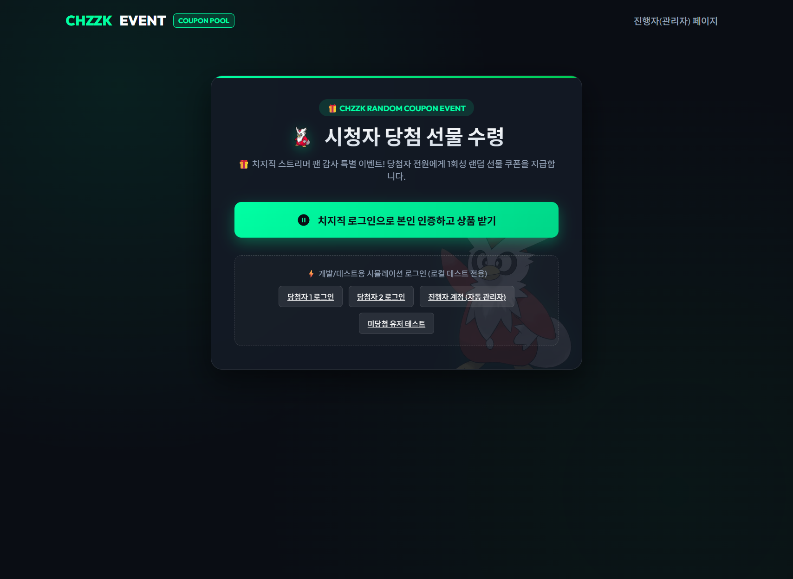
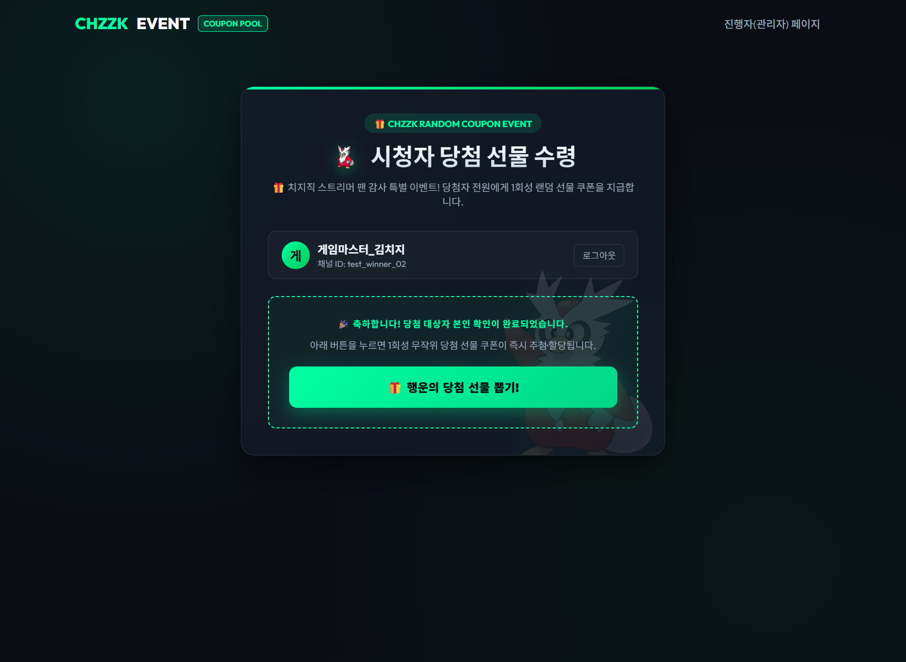
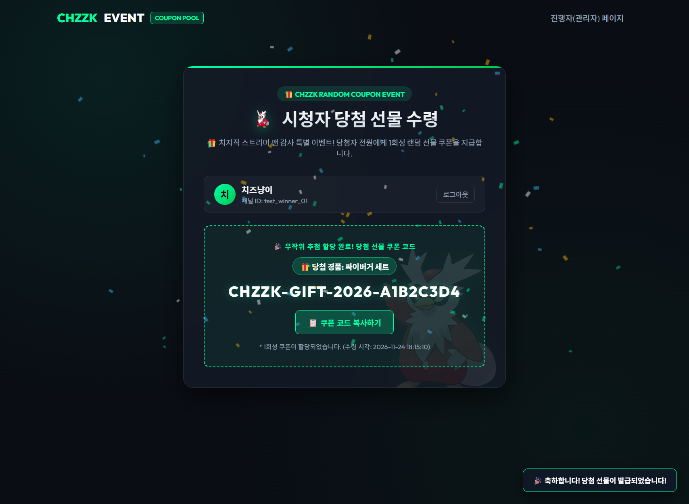
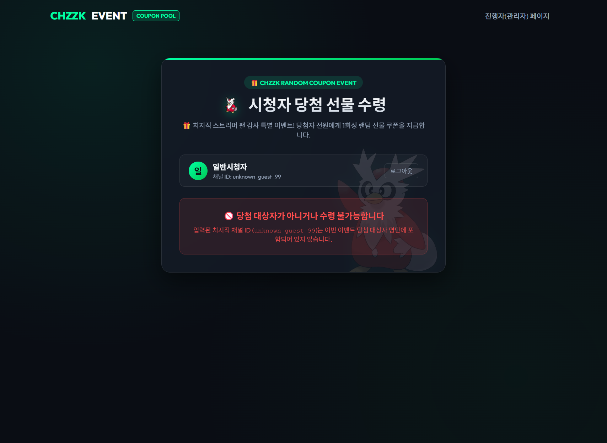
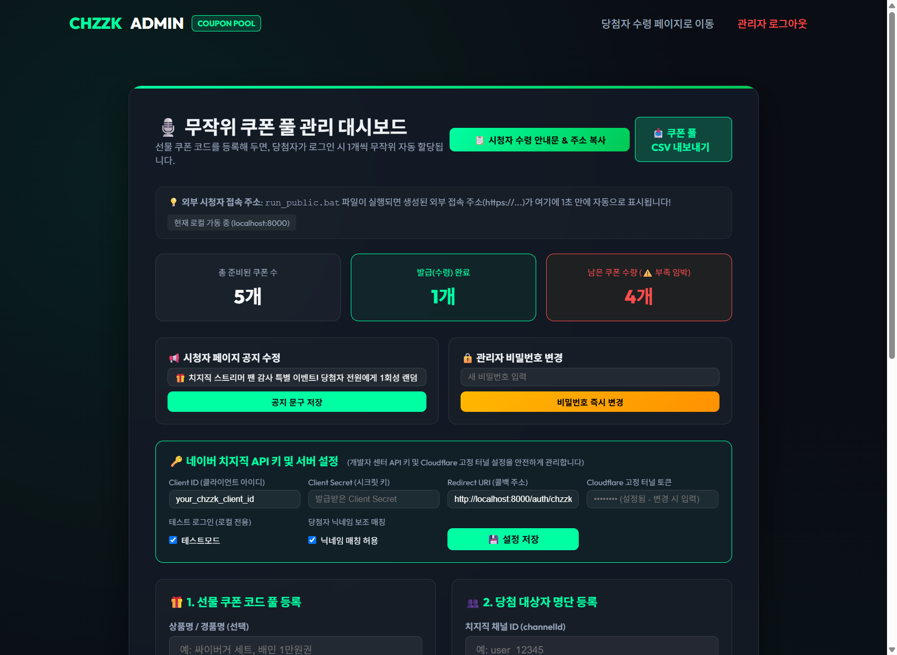
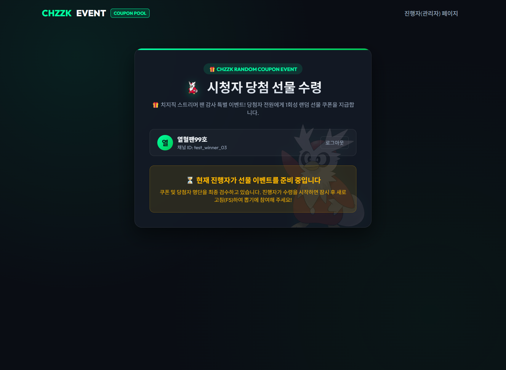
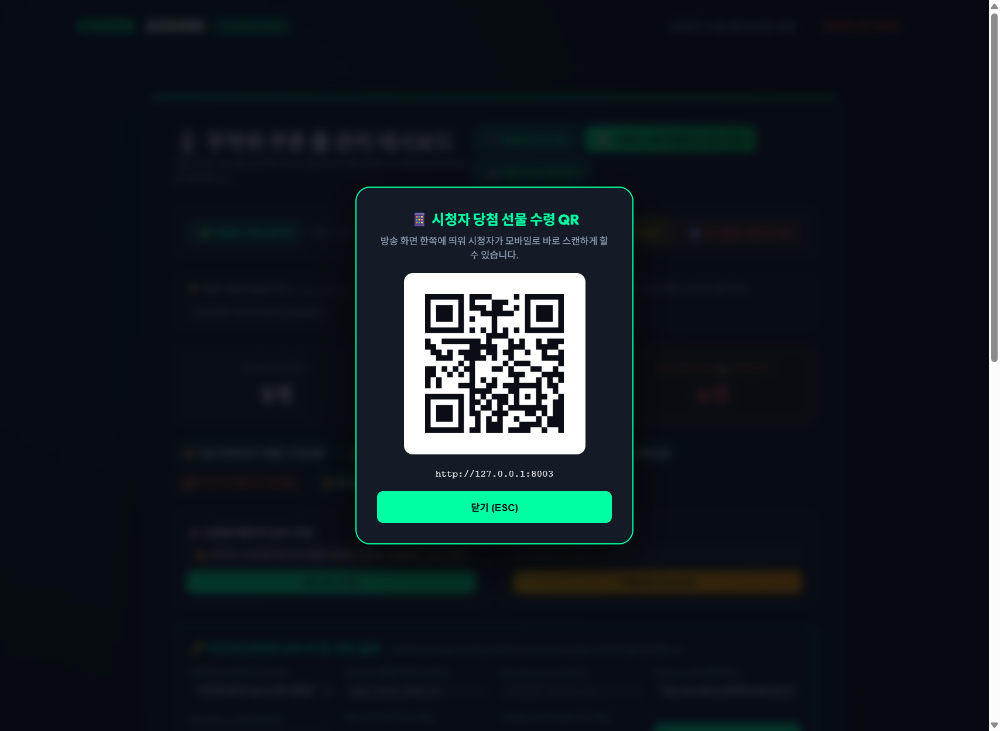
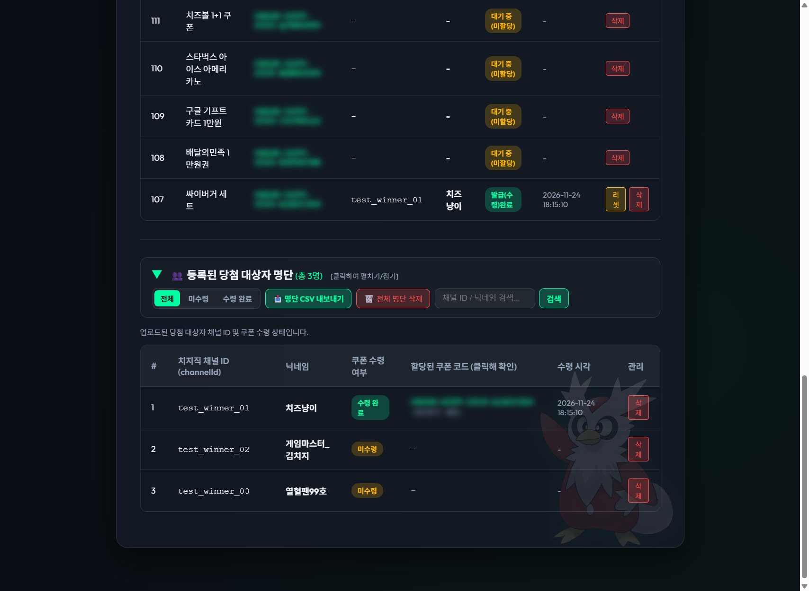

# 🎁 치지직(CHZZK) 1회성 무작위 쿠폰 수령 플랫폼 (인수인계 & 운영 가이드)


치지직(CHZZK) 스트리머 이벤트를 위한 **시청자 본인 인증 기반 1회성 선물 쿠폰 무작위 수령 및 진행자 관리 웹 플랫폼**입니다.  
본 리포지토리 및 프로그램은 타 스트리머, 매니저, 운영진에게 즉시 인수인계하여 안전하게 생방송 이벤트를 진행할 수 있도록 제작되었습니다.

---

## ✨ 핵심 기능 요약

- **🔒 치지직 공식 Open API & 네이버 OAuth 2.0 본인 인증**: 시청자의 고유 `channelId`를 검증하여 엄격한 당첨자 명단 대조 및 중복 수령 원천 차단
- **🎁 명시적 뽑기 연출 (`POST /claim`) & 경품명 표시**: 로그인 직후 자동 차감 대신 당첨자가 **[🎁 행운의 당첨 선물 뽑기!]** 버튼을 클릭하면 폭죽 애니메이션과 함께 경품명·쿠폰 코드 공개
- **🎙️ 진행자 전용 관리자 대시보드 (`/admin`)**:
  - **🟢 이벤트 오픈 / 일시정지 스위치**: 준비·검수 중에는 수령을 일시정지해 두고 세팅 완료 후 원클릭 오픈
  - **👁️ 전 구간 쿠폰 코드 블러 보호**: 미수령·수령 완료 코드 모두 기본 블러 처리하여 생방송 화면 송출 시 스나이핑 방지
  - **📱 방송 송출용 QR 코드 모달 & 5초 실시간 통계/경품별 재고 자동 갱신**
  - **🔑 웹 UI 상에서 API 키·인증 방식·Cloudflare 고정 터널 실시간 설정**
  - 쿠폰(상품명 포함)·당첨자 명단 **여러 줄 붙여넣기 일괄 등록** 및 스마트 CSV 업로드/내보내기
- **🛡️ 로컬 루프백(`127.0.0.1`) 격리 & 프로세스 자동 정리**: 내부망 직접 포트 접근 차단, Windows Job Object 기반 `cloudflared` 자식 프로세스 자동 종료, 무설치 포터블 `.exe` 지원

---

## 📸 주요 서비스 화면 미리보기

### 시청자 참여 흐름

| 1. 첫 접속 (로그인 전) | 2. 본인 확인 완료 · 뽑기 대기 |
| :---: | :---: |
|  |  |
| **3. 쿠폰 수령 완료 (폭죽 연출)** | **4. 미당첨자 접근 제한** |
|  |  |

### 방송 운영 및 보안 제어

| 5. 진행자 관리 대시보드 | 6. 이벤트 일시정지 적용 화면 |
| :---: | :---: |
|  |  |
| **7. 방송 송출용 QR 코드 모달** | **8. 쿠폰 풀 · 당첨자 전 구간 블러 보호** |
|  |  |

---

## 🏷️ 릴리즈 히스토리

각 버전의 상세 변경 내역과 패치 노트는 [GitHub Releases](https://github.com/ManofKimchi08/chzzk-coupon-app/releases)에서 확인할 수 있습니다.

- **v2.3.0 (Latest)** — 고유 `channelId` 사칭 방지 강화, 치지직 공식 Open API + 네이버 OAuth 이중 지원, 명시적 뽑기(`POST /claim`) 및 폭죽 연출, 이벤트 오픈/일시정지 스위치, QR 모달, 전 구간 블러 보호, `tunnel_manager.py` 프로세스 자동 정리
- **v2.2.0** — 생방송 쿠폰 블러 보호, 경품명 등록 및 경품별 재고 집계, 여러 줄 일괄 등록, 5초 실시간 대시보드 폴링
- **v2.1.0** — 레드팀 보안 취약점 7종 패치 (`SECRET_KEY` 자동 생성, 외부 Mock 차단, 로그인 잠금, 시크릿 마스킹, CSV 수식 인젝션 방어)
- **v2.0.0** — `ChzzkCouponServer.exe` 원클릭 실행 및 Cloudflare 터널 통합, CSRF/Timing/DoS 보안 및 SQLite WAL 최적화
- **v1.2.0** — 당첨 대상자 명단 관리 UI, 전체 일괄 초기화, 스마트 CSV 컬럼 자동 인식

---

## 📂 폴더 및 파일 구조

```
chzzk-coupon-app/
├── dist/ChzzkCouponServer/           # 🚀 [인수인계용] 무설치 포터블 패키지 폴더
│   ├── ChzzkCouponServer.exe        # 실행 파일 (더블클릭 시 서버 + Cloudflare 터널 + 브라우저 자동 오픈)
│   ├── cloudflared.exe              # Cloudflare HTTPS 터널 실행 엔진
│   ├── run_public.bat               # 외부 공개 보조 실행 배치 파일
│   ├── .env                         # ⚙️ API 키 및 비밀번호 설정 파일 (웹 UI 또는 메모장으로 수정)
│   └── README.md                    # 상세 운영 매뉴얼 문서
├── database.py                      # SQLite(WAL) 데이터베이스, 동시성 트랜잭션 및 스마트 CSV 파서
├── main.py                          # FastAPI 백엔드 라우터, 보안 미들웨어 및 OAuth 2.0 연동
├── tunnel_manager.py                # Cloudflare 터널 생명주기 및 프로세스 안전 관리 모듈
├── run_app.py                       # 원클릭 실행 진입점 (127.0.0.1 루프백 전용 바인딩)
├── templates/                       # HTML 웹 UI 템플릿 (Jinja2)
└── static/                          # CSS 스타일시트 및 캐릭터 이미지 자산
```

---

## 🔑 필수 환경설정 (웹 UI 또는 `.env` 세팅법)

### 1단계: 치지직 공식 Open API (권장) 또는 네이버 로그인 API 등록

#### 방안 A. 치지직 공식 개발자 센터 (`chzzk.naver.com` / 권장 ⭐)
- 치지직 추첨기 CSV의 고유 ID(`channelId`)와 **100% 동일한 ID 체계**를 사용하므로 닉네임 변경 사칭 걱정 없이 완벽하게 일치합니다.
- **인증 URL**: `https://chzzk.naver.com/account-interlock`
- **Callback URL**: `https://<내_도메인_또는_터널주소>/auth/chzzk/callback`
- 대시보드(`/admin`)의 **인증 방식**에서 **`치지직 공식 Open API (권장)`** 선택 후 **Client ID / Client Secret / Redirect URI**를 저장하세요.

#### 방안 B. 네이버 개발자 센터 (`developers.naver.com` 호환 모드)
1. [네이버 개발자 센터(Naver Developers)](https://developers.naver.com/) 접속 ➔ **[Application] ➔ [애플리케이션 등록]**
2. **사용 API**: `네이버 로그인` 선택 ➔ **별명** 항목 선택
3. **서비스 환경 (`WEB 설정`)**: 서비스 URL(`http://localhost:8000` 또는 터널 주소) 및 Callback URL(`/auth/chzzk/callback`) 입력
4. 대시보드(`/admin`)의 **인증 방식**을 **`네이버 로그인 (네아로 호환)`**으로 선택하고 키를 저장하세요. *(※ 네이버 로그인 고유번호 체계상 닉네임으로만 당첨자를 등록해야 할 경우에만 제한적으로 `닉네임 매칭 허용` 옵션을 사용할 수 있습니다.)*

---

## 🚀 프로그램 실행 방법

### 방법 A: 파이썬 미설치 환경 (무설치 포터블 `.exe` - 권장 ⭐)
1. `dist/ChzzkCouponServer` 폴더로 이동합니다.
2. **`ChzzkCouponServer.exe`** 파일을 더블클릭합니다.
3. 로컬 전용 서버(`127.0.0.1:8000`)와 백그라운드 Cloudflare 터널이 자동으로 켜지고, **웹 브라우저(`/admin`)가 자동으로 열립니다.**

### 방법 B: 파이썬 개발 환경 (Source Code)
```bash
git clone https://github.com/ManofKimchi08/chzzk-coupon-app.git
cd chzzk-coupon-app
python -m venv venv
.\venv\Scripts\activate
pip install -r requirements.txt
python run_app.py
```

---

## 🕹️ 진행자 운영 순서

1. **관리자 로그인**: `/admin` 접속 후 비밀번호(`ADMIN_PASSWORD`) 입력 (또는 스트리머 계정으로 로그인).
2. **준비 중 스위치 켜기**: 쿠폰·명단을 세팅하는 동안 상단의 **`⏸️ 수령 일시정지(준비 중) 전환`**을 눌러 조기 수령을 차단합니다.
3. **쿠폰 & 당첨자 등록**:
   - `[1. 선물 쿠폰 코드 풀 등록]`: 경품명(선택)과 쿠폰 코드를 여러 줄로 붙여넣거나 CSV 일괄 업로드.
   - `[2. 당첨 대상자 명단 등록]`: 당첨자 고유 ID/닉네임을 여러 줄로 붙여넣거나 CSV 일괄 업로드.
4. **수령 오픈 & 방송 송출**: **`▶️ 이벤트 수령 시작하기`** 클릭 후 `[📋 시청자 수령 안내문 & 주소 복사]` 또는 `[📱 방송용 QR 코드]`로 시청자에게 링크를 공유합니다.
5. **이벤트 종료 후 백업**: `[📥 쿠폰 CSV 내보내기]`로 발급 기록을 보관한 뒤 다음 이벤트 시 `[🔄 새 이벤트 전체 초기화]`로 깔끔하게 비울 수 있습니다.

---

## ⚠️ 필수 주의사항

> [!CAUTION]
> **1. `.env` 보안키 및 관리자 비밀번호 관리**  
> `CHZZK_CLIENT_SECRET`, `ADMIN_PASSWORD`, `CLOUDFLARE_TUNNEL_TOKEN`, `SECRET_KEY`가 담긴 `.env` 파일은 절대 외부에 공유하지 마세요. (최초 가동 시 `SECRET_KEY`는 자동으로 256-bit 무작위 난수로 교체됩니다.)

> [!WARNING]
> **2. Callback URL 일치 확인**  
> 치지직/네이버 개발자 센터에 등록한 Callback URL과 관리자 설정의 `Redirect URI`는 마지막 경로(`/auth/chzzk/callback`)까지 정확히 일치해야 합니다.

---

## 📄 라이선스
MIT License
